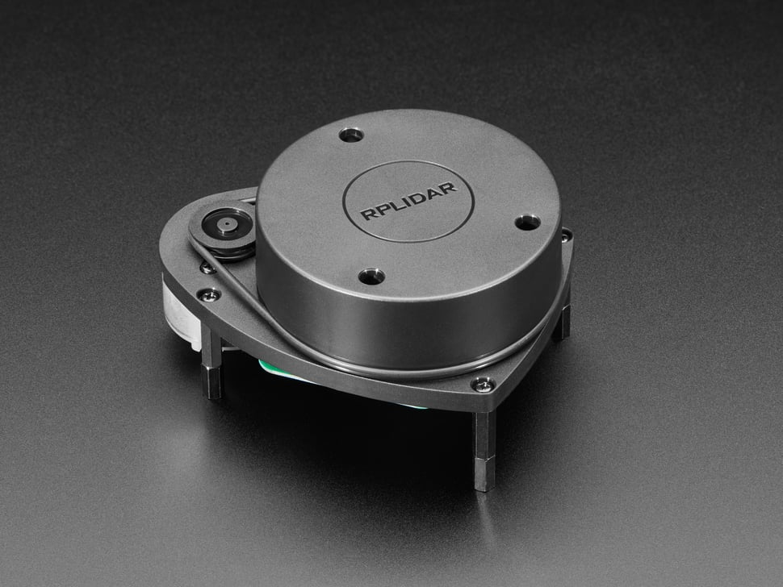

# LiDAR — Technical Documentation

The LiDAR module provides a threaded interface to the **Slamtec RPLidar** sensor via the Adafruit CircuitPython driver. It continuously scans the environment and maintains a 360° range image for the robot.

- **Sensor:** Slamtec RPLidar (A1/A2 family supported)
- **Library:** `adafruit_rplidar`
- **Data Format:** 360-element list, where each index corresponds to a degree angle.

---
[](https://learn.adafruit.com/slamtec-rplidar-on-pi)  
*Click the image to view the manufacturer datasheet.*
---

## Installation & Setup

### Dependencies
```bash
pip install adafruit-circuitpython-rplidar
````

## Orientation Conventions

* Index `0` → **rear** of the robot
* Index `90` → **left**
* Index `180` → **front**
* Index `270` → **right**

These mappings are handled automatically inside the class.

---

## API Reference

```python
from robot_systems.lidar import Lidar
lidar = Lidar(port_name="/dev/ttyUSB0", timeout=3, frequency=20)
```

### Constructor

* `Lidar(port_name="/dev/ttyUSB0", timeout=3, frequency=20)`

  * `port_name`: USB port where the LiDAR is connected.
  * `timeout`: Connection timeout (s).
  * `frequency`: How often to update (Hz). Controls the sleep between scan loops.
  * `stale_after_s` (default `1.0`): Age past which a slot is reported as
    `INVALID_READING` instead of as a distance. See
    [Slot expiry](#slot-expiry) below.

### Methods

* `get_current_scan(max_age_s=-1.0) -> list[int]`
  Returns a 360-length distance array (in mm). Each index = angle. Slots not
  written within the age window read as `INVALID_READING` (`-1`).

  * `max_age_s` negative (the default): use the constructor's `stale_after_s`.
  * `max_age_s` a positive number: use that window instead, just for this call.
  * `max_age_s=None`: no expiry — the raw array, as this method behaved before
    expiry existed.

* `slot_age(degree: int) -> float`
  Seconds since that slot was last written, or `inf` if it never has been.
  The angle is wrapped into 0–359.

* `sample(max_age_s=-1.0) -> tuple[list[int], float | None]`
  A scan together with the write time of its freshest slot. Used by
  `HamBot.step()` to latch the scan with a reading time; see
  [step.md](step.md).

* `set_lidar_frequency(freq: float)`
  Adjusts the scan loop sleep frequency.

* `stop_lidar()`
  Gracefully shuts down: stops thread, motor, and disconnects USB.

---

## Slot expiry

Each of the 360 slots carries the monotonic time it was last written, and a
slot nothing has refreshed within `stale_after_s` is reported as
`INVALID_READING` (`-1`) rather than as a distance.

Before this, `scan_data` slots were never expired, so **a reading from 30
seconds ago was indistinguishable from a fresh one** — a robot could steer
around an obstacle that had long since been carried away. Expiry makes
"nothing is there" distinguishable from "nothing has been measured there
recently".

Always filter before using a reading:

```python
scan = lidar.get_current_scan()
valid = [scan[i] for i in range(160, 201) if scan[i] > 0]   # front window
nearest = min(valid) if valid else None
```

### Choosing the window

The 1.0 s default reasons from a 5–10 Hz spin, which refreshes every visible
angle every 100–200 ms. A slot quiet for a full second is one nothing has
bounced off recently.

If a real unit leaves legitimately visible angles quiet for longer than a
second — a very dark or oblique surface, a slower spin — raise it:

```python
lidar = Lidar(stale_after_s=2.0)
```

Set it too low and readings a demo needs are blanked; too high and the original
staleness problem comes back. Blanking shows up as an obstacle that flickers in
and out of `scan[i] > 0`.

### The write order, and why it matters

The scan thread writes a slot's **distance first and its timestamp second**. A
reader that interleaves between the two therefore sees a new distance carrying
an old timestamp and discards it as stale. That is the safe direction to lose
the race: a good reading is occasionally dropped, a stale one is never served.

---

## Example Usage

### 1) Basic Scan

```python
from robot_systems.lidar import Lidar
import time

lidar = Lidar()
time.sleep(1)  # allow buffer to fill
scan = lidar.get_current_scan()

print("Front distance (mm):", scan[180])
print("Left distance (mm):", scan[90])

lidar.stop_lidar()
```

### 2) Continuous Readout

```python
from robot_systems.lidar import Lidar
import time

lidar = Lidar()
try:
    while True:
        scan = lidar.get_current_scan()
        print(f"Front: {scan[180]} mm, Right: {scan[270]} mm")
        time.sleep(0.5)
finally:
    lidar.stop_lidar()
```

---

## How It Works

1. Starts the RPLidar motor and spawns a background thread.
2. Calls `iter_scans()` from `adafruit_rplidar`.
3. For each measurement:

   * Adjusts angle so that `180°` is front, `0°` is rear.
   * Floors and clamps to the nearest degree.
   * Updates the `scan_data` array with distance in mm.
4. Data is protected with a lock for thread-safe reads.

---

## Performance Tips

* Default frequency is 20 Hz (`lidar_sleep = 1/20`). Lower if CPU is limited.
* Always call `stop_lidar()` before program exit to stop the motor and free USB.

---

## Troubleshooting

* **`RPLidar exception occurred`**:
  Check wiring, USB cable, and power supply. Some hubs cannot supply enough current.
* **No device found**:
  Ensure the LiDAR is visible under `/dev/ttyUSB*`. Add user to `dialout` group.
* **Laggy updates**:
  Lower `frequency` to reduce CPU usage.

---

